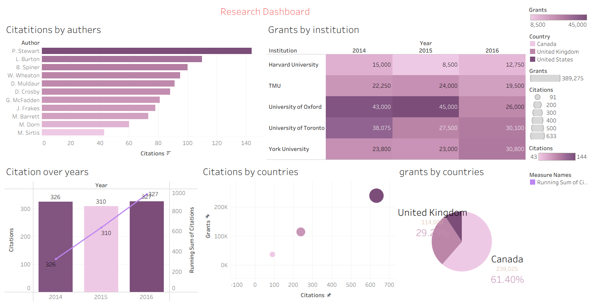
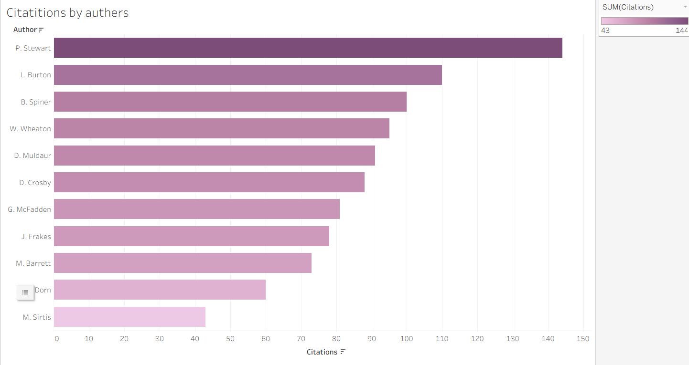
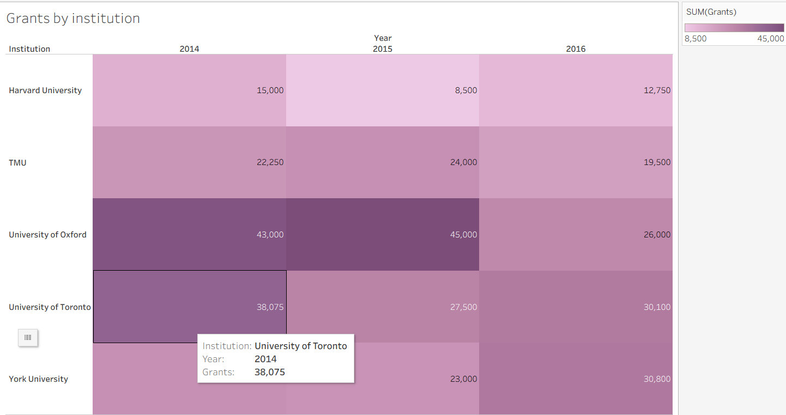
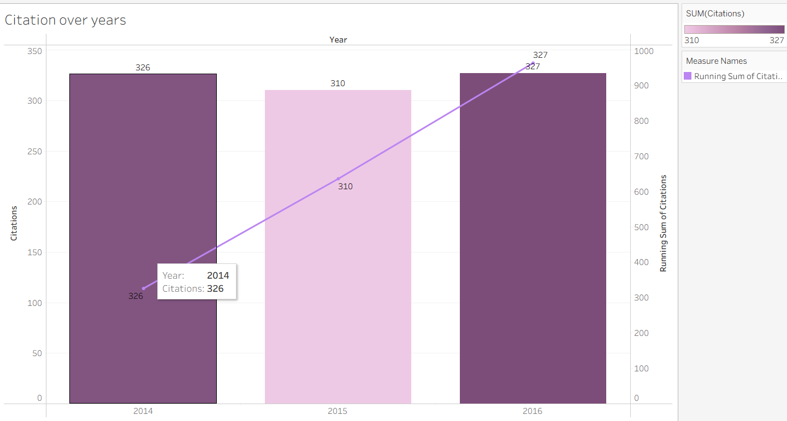
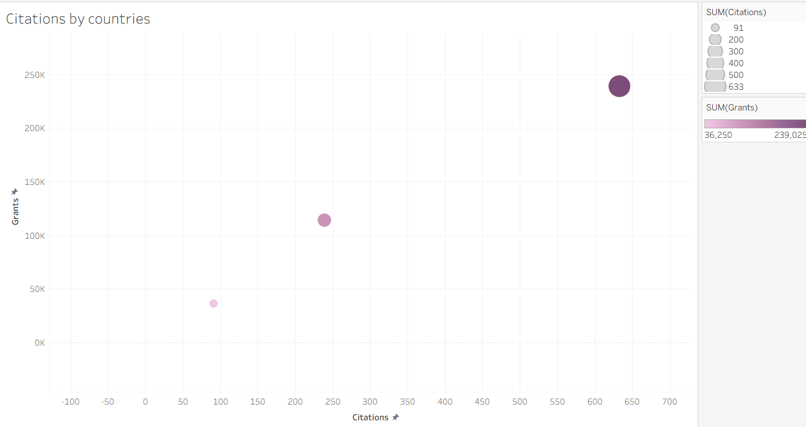
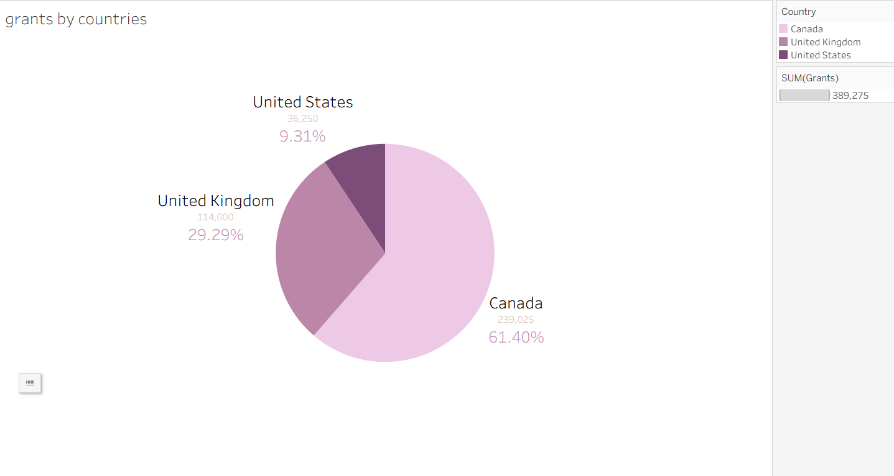

# Academic Research & Grants Performance Dashboard

An analytical data visualization project built with **Tableau** to track and evaluate academic research impact, citation performance, and grant funding distribution across institutions, authors, and countries from 2014 to 2016[cite: 9].

---

## 📌 Main Dashboard Overview

This interactive dashboard consolidates academic impact metrics (Citations) and financial support data (Grants), enabling educational institutions and stakeholders to assess research funding efficiency relative to scientific output[cite: 9].

---

## 🔍 Detailed Analysis & Key Insights (Individual Sheets)

### 1. Citations by Authors

* **Overview:** A horizontal bar chart ranking researchers based on the total number of citations accrued by their published papers[cite: 9].
* **Key Insights:**
  * **P. Stewart** leads the research impact with the highest citation count, exceeding **140 citations**[cite: 9].
  * Followed closely by **L. Burton** (over 100 citations), **B. Spiner**, and **W. Wheaton**, highlighting their high-impact contributions[cite: 9].
  * The remaining researchers range between 40 and 95 citations, demonstrating varied publication reach across the academic cohort[cite: 9].

---

### 2. Grants by Institution

* **Overview:** A highlight table (Heat Map) illustrating the volume of grant funding allocated to major universities across 2014, 2015, and 2016[cite: 9].
* **Key Insights:**
  * **University of Oxford** secured the highest individual funding allocations, peaking at **$45,000** in 2015 and **$43,000** in 2014[cite: 9].
  * **University of Toronto** and **York University** maintained strong, consistent grant streams, both surpassing **$30,000** in 2016[cite: 9].
  * **Harvard University** experienced a funding dip in 2015 (**$8,500**) before rebounding to **$12,750** in 2016[cite: 9].

---

### 3. Citation Over Years

* **Overview:** A dual-axis combination chart pairing annual citation volume bars with a cumulative running total line[cite: 9].
* **Key Insights:**
  * Annual citation output remained highly stable year-over-year: **326** in 2014, **310** in 2015, and **327** in 2016[cite: 9].
  * The running total of citations demonstrates a steady linear upward trajectory, approaching **1,000 cumulative citations** by the end of 2016[cite: 9].

---

### 4. Citations vs. Grants by Countries

* **Overview:** A bubble scatter plot comparing total grant funding received against total citations generated per country[cite: 9].
* **Key Insights:**
  * Evaluates the return on research investment across nations, highlighting high-performing regions that achieved over **600 citations** alongside receiving more than **$200K** in grant funding[cite: 9].

---

### 5. Grants Distribution by Countries

* **Overview:** A pie chart breaking down the proportional share of total research grants across participating countries[cite: 9].
* **Key Insights:**
  * **Canada** captured the dominant share of research funding, securing **$239,025** (**61.40%** of total grants)[cite: 9].
  * **United Kingdom** ranked second with **$114,000** in funding, accounting for **29.29%** of the total allocation[cite: 9].
  * **United States** accounted for the remaining share of the distributed grants[cite: 9].

---

## 🛠️ Repository Structure & Tools

* **`dashboard.twbx`**: The packaged Tableau workbook containing the interactive dashboard and all individual worksheets[cite: 9, 10].
* **`AuthorDataCitationsGrants.xlsx`**: The primary dataset powering the analysis[cite: 10].
* **`images/`**: Directory containing high-resolution exports of the main dashboard and each individual analytical sheet[cite: 10].
